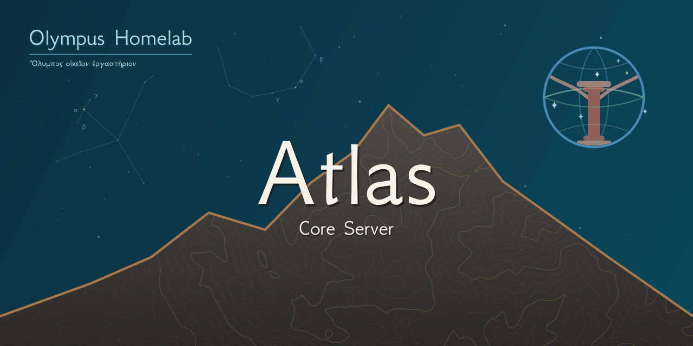
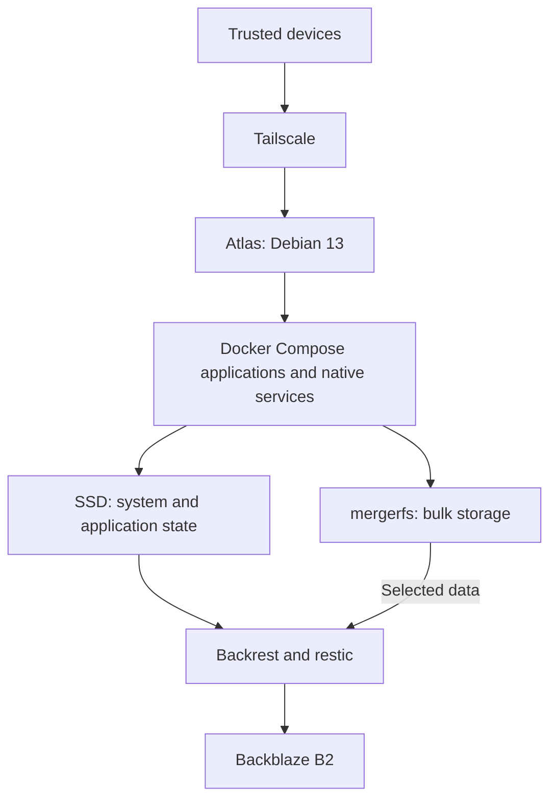

# Atlas

_A self-hosted Debian homelab built from reused hardware._

## About

Atlas is my Debian 13 home server, built from reused desktop hardware. I use it for file and photo storage, media services, backups and development.

This repository contains documentation about its architecture, hardware, services and storage setup. I use it as a reference for maintaining and developing Atlas, and as a way to share what I've built with others.

## Architecture

Atlas runs Debian 13, with most applications deployed through Docker Compose and host-level tasks managed through native services.

Tailscale provides private remote access to Atlas, allowing me to reach its services and SSH from my laptop and other trusted devices, even when I'm away from home.

Application configuration, databases and development files are stored on the SSD, while larger file, photo and media libraries use a `mergerfs` pool across two hard drives.

Selected data is backed up off-site to Backblaze B2 using `restic`, with Backrest providing backup management and monitoring.

For more detail, see [Architecture](docs/architecture.md) and [Storage and Backups](docs/storage-and-backups.md).

## Services

Atlas hosts several self-hosted applications for everyday use.

| Service | Purpose |
| :-- | :-- |
| **Nextcloud** | File synchronisation, calendars and contacts |
| **Immich** | Photo and video management with GPU-assisted machine learning |
| **Jellyfin** | Media streaming with hardware acceleration and NVIDIA Shield playback |
| **Uptime Kuma** | Service availability monitoring and failure notifications |
| **Backrest** | Management of encrypted off-site backups using restic and Backblaze B2 |

Atlas also hosts private Git repositories, remote development workspaces and smaller utilities for day-to-day use.

See [Services](docs/services.md) for the full list of applications and supporting services.

## Tech Stack

| Category | Technologies |
| :-- | :-- |
| **Operating System** | Debian 13, systemd |
| **Containers** | Docker, Docker Compose |
| **Storage** | mergerfs, SSD/HDD tiering |
| **Networking** | Tailscale, SSH |
| **Backups** | Backrest, restic, Backblaze B2 |
| **Monitoring** | Uptime Kuma, smartd |
| **Development** | Git, VSCodium Remote SSH |

## Documentation

More detailed information about Atlas is available in the `docs/` directory.

| Document | Description |
| :-- | :-- |
| [Architecture](docs/architecture.md) | System architecture, networking and device interactions |
| [Hardware](docs/hardware.md) | Hardware specifications, component reuse and limitations |
| [Services](docs/services.md) | Hosted applications, monitoring and administration |
| [Storage and Backups](docs/storage-and-backups.md) | Storage layout, backup coverage and restore testing |
| [Development Workflow](docs/development-workflow.md) | Private Git hosting and development across multiple computers |
| [Roadmap](docs/roadmap.md) | Current work, planned improvements and ideas under consideration |

These pages explain how Atlas is organised and maintained, rather than providing a step-by-step installation guide. If you're interested in any part of the setup or would like to know more, feel free to get in touch.

> **Documentation status:** All six supporting documents are currently AI-generated drafts. I'm reviewing their contents and will replace them with human-written versions as I work through them.

## Roadmap

**Current Status:** Operational and in regular use for file and photo storage, media streaming, backups and development.

**Current Focus:** Cross-machine Git workflow validation, rewriting the public documentation and further backup recovery testing.

- [x] Set up Debian 13, Docker Compose services and private Tailscale access.
- [x] Configure SSD application storage and mergerfs bulk storage.
- [x] Implement encrypted off-site backups and test selected file and database restores.
- [ ] **Private Git workflow across Atlas, Pegasus and Athena.**
- [ ] Finish reviewing and rewriting the public documentation.
- [ ] Continue recovery testing, including a complete server rebuild, and verify newer services.
- [ ] Plan storage expansion, accounting for redundancy and a 3-2-1 backup strategy.
- [ ] Investigate Prometheus, Grafana, and custom monitoring dashboard options.
- [ ] Explore a private Git management and review interface for coordinating work between the Git server and GitHub.
- [ ] Explore an Atlas Assistant AI for read-only system and Git monitoring, maintenance suggestions and periodic email reports.

This is a brief overview of the main roadmap items. See the [detailed roadmap](docs/roadmap.md) for additional work and ideas not listed here.

## Licence

[Apache-2.0](LICENSE)
