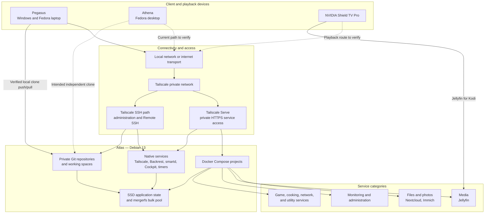
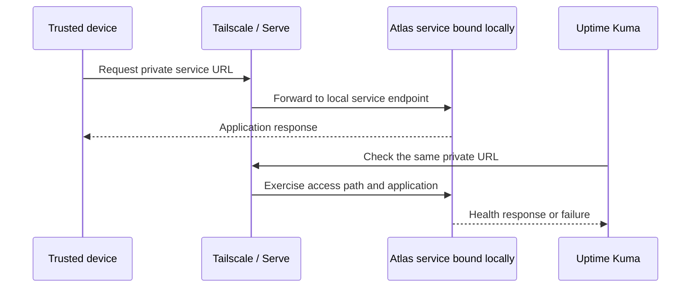

# Atlas environment architecture

> [!WARNING]
> **Transparency:** this document was generated by AI and will be replaced with a human-written version soon.

## Scope and evidence boundary

- Atlas is the central Debian server for services, storage, monitoring, backups, private Git hosting, and remote development.
- Pegasus is the verified Windows/Fedora laptop client for Tailscale SSH, VSCodium Remote SSH, Nextcloud-synchronised files, and Git workflows.
- Athena is the Fedora desktop and the natural machine for GPU-heavy or local build work, but its current Atlas workflow was not inspected in the latest canonical review.
- The NVIDIA Shield TV Pro is the media-playback device and uses the Jellyfin for Kodi add-on.
- Atlas service interfaces and SSH are reached through Tailscale rather than being published as ordinary LAN administration endpoints.

## Devices and responsibilities

| Device | Verified or intended role | Public boundary |
| :-- | :-- | :-- |
| **Atlas** | Debian 13 server; Compose applications; native monitoring, access, backup, and maintenance services; storage; private Git remotes and workspaces | Hardware can be described as reused consumer PC hardware without publishing identifiers |
| **Pegasus** | Main portable client; local Windows portfolio working copy; verified SSH, Tailscale, Git, and Remote SSH path to Atlas | Confirm whether Fedora on Pegasus currently uses the same workflows |
| **Athena** | Fedora desktop; intended local clone and GPU/build environment, with Atlas as a repository and remote workspace host | Latest records say Athena was offline during inspection; confirm current clones and access before presenting them as implemented |
| **NVIDIA Shield TV Pro** | Tailnet-connected media device using the Jellyfin for Kodi add-on | Keep the public explanation at the application level rather than publishing connection details |

## Whole-environment overview

## Local network and Tailscale access

- Atlas is physically connected to the local network, and clients may be local or remote.
- Web interfaces bind to the Atlas host locally and are exposed to trusted devices through Tailscale Serve.
- SSH accepts the local host and Tailscale interface, making Tailscale the verified remote administration route.
- Services start independently of Tailscale where possible, then become reachable when the private access layer is available.
- The trade-off is a smaller public attack surface and one consistent access model, at the cost of depending on tailnet availability for normal administration.

### Service-access and monitoring path

## Docker Compose service organisation

- Each application group is managed as a distinct Compose project.
- Application configuration and state live on the SSD separately from Compose definitions and bulk libraries.
- Bulk file, photo, and media data use the mergerfs pool where appropriate.
- Databases have service health checks and dependency ordering where the application needs them.
- Most containers use restart policies; the Minecraft controller is a documented exception supervised by a native system service because it depends on storage and network readiness.
- Native services are used for responsibilities that belong to the host: private networking, backups, disk monitoring, host administration, and scheduled verification.

## File, media, and development workflows

### Files and photos

- Nextcloud provides synchronised files and collaboration data.
- Immich stores and processes the photo library, including a GPU-backed machine-learning component.
- Large user data is kept separate from the applications' SSD-resident state and databases.
- Pegasus is a verified Nextcloud client in the current portfolio workflow; other device relationships should be confirmed before publication.

### Media

- Jellyfin runs on Atlas and uses the bulk media area.
- GPU support is available to the media/photo workloads where configured.
- The Shield uses Kodi with the Jellyfin integration to play media served by Atlas.

### Development

- Private bare repositories on Atlas provide an SSH Git remote.
- Atlas also holds editable working copies for VSCodium Remote SSH.
- Pegasus keeps an independent local clone and synchronises by normal Git push and pull, not through Nextcloud.
- The intended design gives Athena its own clone for local GPU or build work, but this needs current verification.
- Source, Git metadata, dependencies, and active work stay on SSD; large datasets and archives can use bulk storage only when needed.

## Monitoring and administration

- Uptime Kuma checks user-facing service paths through Tailscale and sends failure notifications.
- Container health checks cover databases and applications that provide a suitable endpoint.
- A post-boot verification service checks mounts, services, networking, DNS, backup access, monitoring, and GPU availability.
- smartd covers disk health; host maintenance remains separate from application containers.
- Cockpit provides host administration and metrics; Homer provides a service dashboard; container logs are available through a read-only-oriented log viewer.
- Backup, repository-prune, and integrity-check outcomes report independently to monitoring.

## Architectural choices and trade-offs

- **Reused hardware:** low-cost and educational, but ageing drives require monitoring, off-site backup, and realistic recovery limitations.
- **Compose plus native services:** keeps applications portable while leaving host responsibilities with systemd; the boundary adds two lifecycle models to understand.
- **Tailscale-first access:** avoids public administration endpoints and works from different networks; normal access depends on the tailnet and its host state must be recreated after a full rebuild.
- **SSD/HDD tiering:** improves latency for databases, Git, and application state while providing bulk capacity; data placement and backup coverage must be documented explicitly.
- **Independent local clones:** allow offline work and machine-specific tools; Git rather than file synchronisation must coordinate source changes.
- **Monitoring through the access layer:** detects more than a running process, but a single tailnet problem can affect several checks at once.
