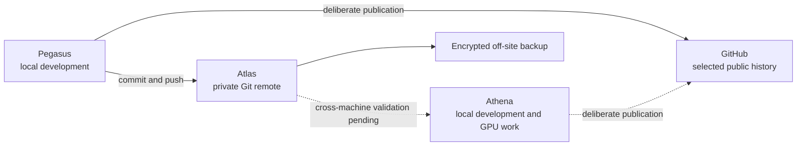

# Atlas development workflow

> [!WARNING]
> **Transparency:** this document was generated by AI and will be replaced with a human-written version soon.

Atlas supports development across my computers without turning unfinished work into public GitHub history. The working model combines local clones, private Git hosting on Atlas, SSH-based access, and deliberate publication when a project is ready.

## Current roles

| System | Current or intended responsibility | Evidence boundary |
| :-- | :-- | :-- |
| Atlas | Private bare Git repositories, a remote development workspace, backups, and SSH access | Implemented and used |
| Pegasus | Primary laptop for local development, Git, and VSCodium Remote SSH | Windows workflow verified; Fedora workflow still needs current validation |
| Athena | Desktop intended for local clones, GPU work, and larger development workloads | Role is planned, but its latest end-to-end workflow has not been verified |
| GitHub | Public home for selected finished projects and portfolio material | Publication remains a deliberate separate action |

Each operating-system installation has its own local clone. Active Git repositories are coordinated through Git rather than file-synchronisation software, avoiding shared working trees and synchronised `.git` internals.

## Current workflow

- Work begins in a local clone rather than directly inside a synchronised cloud folder.
- Intermediate commits and branches can remain private on Atlas.
- Atlas workspaces can be opened through VSCodium Remote SSH where the server environment is useful.
- Public GitHub changes are reviewed separately and are not an automatic consequence of committing to Atlas.
- Private repositories and workspaces are included in the independent backup plan; GitHub is not treated as their backup.

## Cross-machine validation still required

- Complete the current Pegasus-to-Atlas-to-Athena round trip with disposable or non-critical work first.
- Confirm Git identity, signing, SSH forwarding, fetch, push, and recovery behaviour on each operating-system installation.
- Verify that build outputs, dependencies, and private files remain excluded where intended.
- Exercise a repository restore from the off-site backup and validate its references and object database.
- Document conflict handling when independent work has taken place on more than one machine.

## Proposed Git review interface

The local backlog includes an idea for a lightweight Atlas Git Manager. It is not intended to replace GitHub or begin as a full software forge.

### First useful stage: read-only review

- List repositories, branches, remotes, commits, and differences.
- Show commit graphs and combined diffs without modifying real repositories.
- Surface branch divergence, missing dependencies, conflicts, and unpublished Atlas-only work.
- Use disposable repositories while validating parsing and Git behaviour.

### Later publication preparation

- Prepare a temporary publication branch without rewriting the original private history.
- Support a full feature-branch squash or deliberately selected commits as separate workflows.
- Preview the complete proposed diff and commit message before any change.
- Require explicit confirmation before commits, pushes, or pull-request creation.
- Avoid force-pushing and destructive history rewriting by default.

### Optional GitHub integration

- Use GitHub APIs only where they add value, such as displaying pull requests or CI status and opening a reviewed publication pull request.
- Keep ordinary repository operations local where possible.
- If authenticated integration becomes necessary, design narrowly scoped permissions and credential handling before implementation.
- Reconsider an established forge such as Forgejo or Gitea if the required scope grows beyond a small review tool.

## Design constraints

- Private repositories remain reachable only through the private access model.
- Interrupted or conflicting operations must fail without damaging the original history.
- Backups and recovery tests must cover Atlas-only work that does not exist on GitHub.
- A proposed interface is not permission to publish, push, rewrite history, or change repository visibility.
- The read-only stage must provide useful value before write operations are considered.

The project status and sequencing are summarised in the [Roadmap](roadmap.md).

