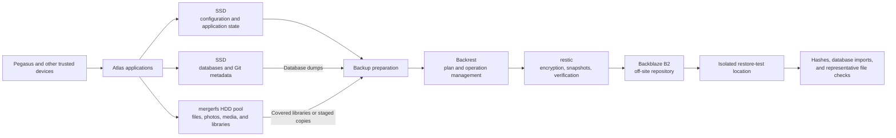

# Atlas storage and backups

> [!WARNING]
> **Transparency:** this document was generated by AI and will be replaced with a human-written version soon.

## Storage layers

### SSD: operating system and active state

- Debian system data and host services.
- Docker and application configuration.
- Databases and latency-sensitive application state.
- Compose definitions, documentation, private Git repositories, and active development workspaces.
- Selected database dumps and backup staging metadata before restic reads them.
- Constraint: the SSD is older consumer hardware with limited capacity, so large libraries do not belong here by default.

### Bulk disks: mergerfs pool

- Multiple ordinary filesystems presented as one bulk-data namespace through mergerfs.
- Nextcloud user data, the Immich library, media, and backup staging where applicable.
- Files remain on the underlying disks rather than being striped as a RAID array.
- Creation policy places new files according to available space; an individual file remains on one underlying disk.
- Trade-off: simple capacity pooling and recoverable ordinary filesystems, without RAID redundancy or filesystem snapshots.

## Why application state and bulk data are separated

- Databases, Git object stores, dependencies, and small-file workloads benefit from SSD latency.
- Photos, synchronised files, and media require capacity more than low-latency metadata access.
- Compose definitions can be restored independently from application data.
- Database dumps or consistent staging copies are safer backup inputs than copying every live database directory.
- The mergerfs pool is not treated as redundancy; important covered data still needs the independent B2 backup.
- Empty or reproducible libraries can remain outside the backup only when that limitation is recorded explicitly.

## Storage relationships

## Backup design

- Backrest is the management and monitoring interface; restic is the backup engine.
- The repository is encrypted before data reaches Backblaze B2.
- Application files, configuration, Compose definitions, internal documentation, home data, Git repositories, and selected bulk libraries are covered.
- Live relational-database directories are excluded; database dumps are produced instead.
- Nextcloud is backed up through a consistent staging copy containing files, configuration, extensions, a database dump, and a manifest.
- Backup, repository-prune, and partial-integrity-check outcomes are monitored separately.
- Restore tests always target an isolated location before any decision about live data.

## Verified coverage and recovery evidence

| Area | Verified evidence | Limitation to retain |
| :-- | :-- | :-- |
| Host configuration and application state | Included; representative file restores have been exercised | A whole-host restoration has not been completed |
| Compose definitions and internal documentation | Included; documentation restored byte-for-byte against backup-time hashes | Public documentation should not reproduce the private operational records |
| Private Git repositories and workspaces | Included, with build outputs and dependencies excluded | Full repository recovery remains to be exercised as part of the development pilot |
| Immich library | Included; a representative sample of original files was restored and checked | A complete library restore was not performed |
| Nextcloud | Consistent staging copy; representative files, configuration, and database import were tested | End-to-end recovery of the complete live service remains broader than the component tests |
| Relational and SQLite databases | Dumps included; all recorded database types were restored or integrity-checked in isolation | Importing into rebuilt production services still needs controlled execution |
| Minecraft backups | Backup archive restored and checked | Import through the application was not tested |
| Media | Recorded as outside current coverage | Reassess before real data is added |

## Recovery considerations

- Restore into a separate location, verify, then decide whether to copy data into place.
- Production restore, service downtime, snapshot deletion, repository maintenance, and key changes are separate approval-gated operations.
- Database recovery requires matching a consistent data copy with the corresponding dump.
- File ownership and permissions are part of recovery evidence, not an afterthought.
- Docker images and reproducible caches can be pulled or regenerated rather than backed up.
- Tailscale node state and service mappings are recreated during a full rebuild rather than restored from the repository.
- A complete bare-metal rebuild, including GPU setup and rejoining the tailnet, has not been rehearsed.
- A full off-site download time and any provider-side download constraints remain unverified.

## Significant decisions and trade-offs

- **mergerfs instead of RAID or a snapshot filesystem:** simpler pooling over ordinary filesystems, but no redundancy and no native snapshots.
- **B2 as the independent copy:** protects against loss of Atlas and its local disks, but recovery depends on external credentials being held separately and tested.
- **Application-aware preparation:** staging and dumps add complexity but avoid presenting a crash-consistent copy as an application-consistent backup.
- **Selective coverage:** reduces cost and noise by excluding reproducible or empty data, but every exclusion must be reconsidered when the workload changes.
- **Representative restore tests:** give direct evidence for files and databases without overwriting live data, but do not equal a rehearsed full disaster recovery.
